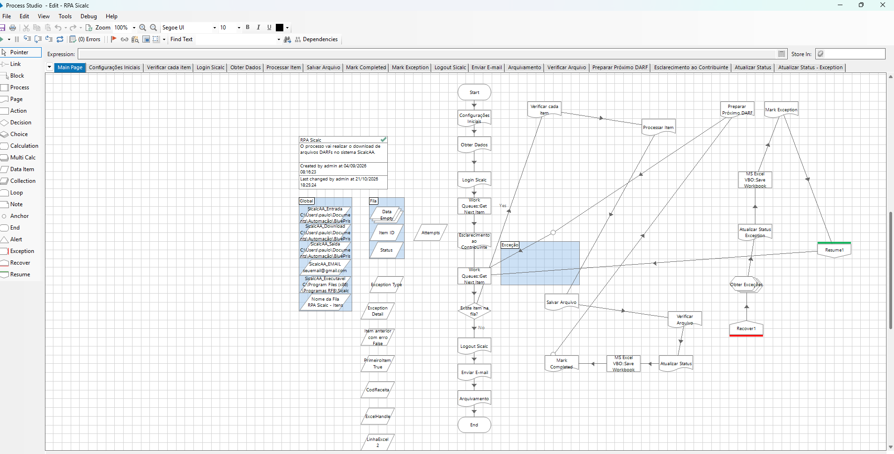
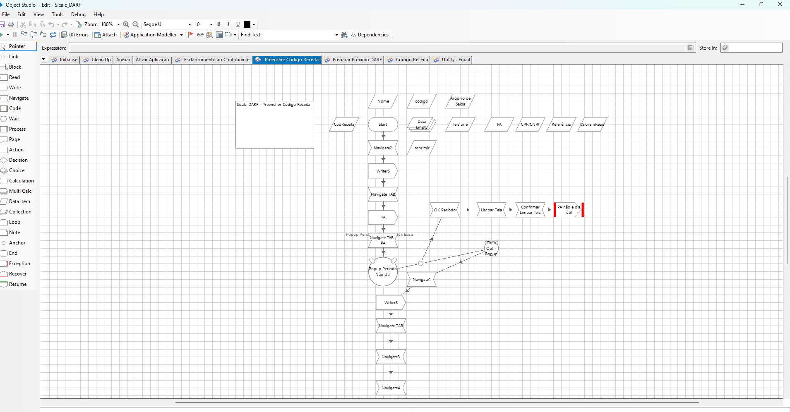
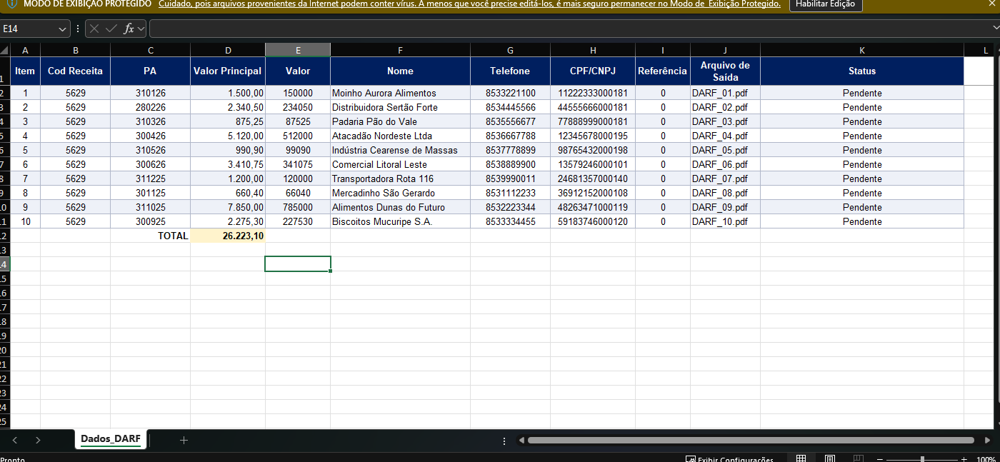
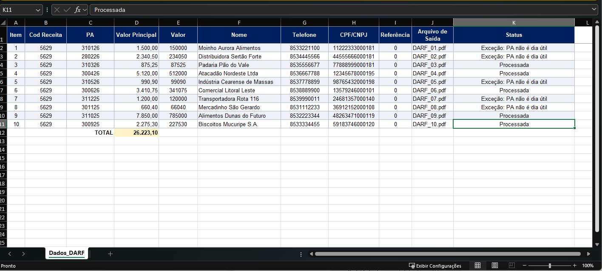
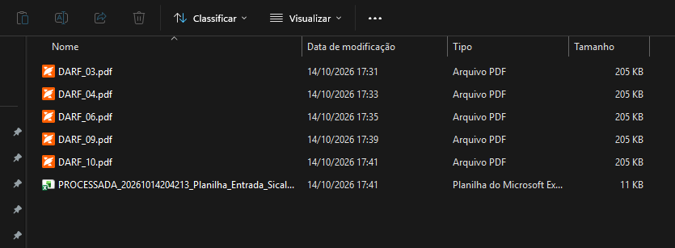

# RPA Sicalc · Baixar DARFs no SicalcAA

Projeto final da Pós-graduação em Automação Robótica e Agentes Inteligentes (UNIFOR). É um robô em **Blue Prism Enterprise 7.5.1** que lê uma planilha de DARFs, preenche cada um no SicalcAA, salva os PDFs, atualiza o status na planilha e envia um resumo por e-mail com os arquivos anexados.

## O que o robô faz

1. Lê a planilha de entrada (aba `Dados_DARF`) e carrega os itens na Work Queue **RPA Sicalc - Itens**.
2. Para cada item (via **Get Next Item**):
   - preenche o DARF no SicalcAA (código de receita, período de apuração, valor, contribuinte);
   - gera e verifica o PDF em `SicalcAA\Saida`;
   - grava o status na coluna K da planilha (`Processada` ou `Exceção: <motivo>`);
   - marca o item como concluído ou como exceção na fila.
3. Ao final, envia um e-mail de resumo com os PDFs anexados e arquiva a planilha com o prefixo `PROCESSADA_` e data/hora.

## Telas

**Processo principal (Main Page):** configurações iniciais, login, laço da Work Queue, bloco de exceção com Recover/Resume, envio de e-mail e arquivamento.

**Business Object Sicalc_DARF, página Preencher Código Receita:** preenchimento dos campos no SicalcAA e tratamento do popup "PA não é dia útil" como exceção de negócio.

## Resultado da execução

Execução com 10 DARFs de exemplo: 5 processados e 5 rejeitados como exceção de negócio, porque o período de apuração não era dia útil.

**Planilha antes:** todos os itens com status `Pendente`.

**Planilha depois:** cada linha terminou como `Processada` ou `Exceção: <motivo>`. Nenhum item ficou pendente.

**Pasta de saída:** os 5 PDFs gerados e a planilha arquivada com o prefixo `PROCESSADA_` e data/hora.

## Tratamento de exceções

- **Exceção de negócio:** o item viola uma regra do processo (por exemplo, o PA não é dia útil). O robô gera uma *Business Exception* com o motivo e continua.
- **Exceção de sistema:** falha inesperada na aplicação, no arquivo ou na planilha. O mesmo bloco **Recover** captura o erro com o detalhe técnico.

Nos dois casos o motivo vai para a planilha e para o *Exception Reason* da fila. O robô segue para o próximo item via **Resume**, e nenhum item fica pendente.

Mais detalhes no PDF [Decisões de Arquitetura](<Decisoes_Arquitetura_RPA_Sicalc_Paulo_Victor (1).pdf>).

## Arquivos

| Arquivo | Descrição |
|---|---|
| `v2 - Entrega Final.bprelease` | Pacote completo para importar no Blue Prism (processo, objetos, fila e variáveis de ambiente) |
| `BPA Process - RPA Sicalc_Paulo.bpprocess` | Processo principal (orquestração e laço da fila) |
| `BPA Object - Sicalc_DARF_Paulo.bpobject` | Business Object que interage com o SicalcAA |
| `Microsoft Outlook Email VBO (NetOffice) v10.4.7.bpobject` | VBO usado para enviar o e-mail de resumo |
| `SicalcAA/Entrada/Planilha_Entrada_SicalcAA.xlsx` | Planilha de exemplo com dados fictícios |
| `SicalcAA/Saida`, `SicalcAA/Download` | Pastas de saída dos PDFs e downloads (criadas na sua máquina; não vão para o GitHub por estarem vazias) |
| `imagens/` | Prints do Process Studio, do Object Studio e do resultado da execução |

## Como executar

1. No Blue Prism, vá em **File → Import → Release/Skill** e importe `v2 - Entrega Final.bprelease`.
2. Em **System → Environment Variables**, ajuste as variáveis `SicalcAA_*` para o seu ambiente: pastas de entrada, saída e download, caminho do executável do SicalcAA e o destinatário do e-mail (`SicalcAA_EMAIL`).
3. Deixe o Microsoft Outlook aberto e logado na máquina. O VBO usa a sessão do Outlook, então não há credencial no pacote.
4. Coloque a planilha de entrada na pasta configurada e execute o processo **RPA Sicalc** no Control Room.

## Tecnologias

Blue Prism Enterprise 7.5.1 · Work Queues · MS Excel VBO · Utility - File Management · MS Outlook Email VBO (NetOffice)

## Autor

Paulo Victor Martins Carneiro
